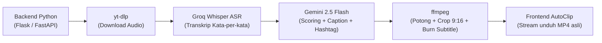

# 📋 AutoClip AI Studio — Laporan Progres & Rencana Perbaikan

> Diperbarui: 25 November 2026 | Versi: v2.4.0

---

## ✅ Yang Sudah Dikerjakan

### 1. Setup Proyek & Dependensi
| Item | Status | Keterangan |
|------|--------|------------|
| React 18 + Vite 6 | ✅ Selesai | Build tool modern, HMR aktif |
| Tailwind CSS v3 | ✅ Selesai | Dark mode studio design system |
| Lucide React Icons | ✅ Selesai | Fixed ESM build error (patch manual) |
| canvas-confetti | ✅ Selesai | Animasi saat klip berhasil diunduh |
| yt-dlp (Python) | ✅ Selesai | Unduh video & subtitle dari YouTube |

---

### 2. Konfigurasi API Keys
| API | Status | Endpoint |
|-----|--------|----------|
| **Google Gemini 2.5 Flash** | ✅ Dikonfigurasi & Diuji | `generativelanguage.googleapis.com` |
| **Groq Cloud (Whisper Large v3)** | ✅ Dikonfigurasi & Diuji | `api.groq.com` (ASR transkrip) |
| **OpenAI** | ⬜ Tersedia (opsional) | Kolom input tersedia di UI |
| **DeepSeek** | ⬜ Tersedia (opsional) | Kolom input tersedia di UI |

API Keys disimpan di:
- [`.env`](file:///d:/Autoclip/autoclip/.env) — API keys produksi
- [`.env.example`](file:///d:/Autoclip/autoclip/.env.example) — Template publik tanpa value

---

### 3. Ekstraksi Data Video Sumber (dr. Tirta — Rintik Obrolan)
| Data | Status | File |
|------|--------|------|
| Metadata video (views, likes, durasi) | ✅ Selesai | [`video_info.json`](file:///d:/Autoclip/autoclip/video_info.json) |
| Subtitle/transkrip VTT Indonesia | ✅ Selesai | [`drtirta_sub.id.vtt`](file:///d:/Autoclip/autoclip/drtirta_sub.id.vtt) |
| 8 klip otentik verbatim dr. Tirta | ✅ Selesai | [`authentic_clips.json`](file:///d:/Autoclip/autoclip/authentic_clips.json) |
| Transkrip bersih JSON | ✅ Selesai | [`transcript_clean.json`](file:///d:/Autoclip/autoclip/transcript_clean.json) |

---

### 4. Fitur Utama Frontend (App.jsx)

#### 4A. Galeri Klip & Panel Kontrol
- [x] **Klip Fleksibel 1–8+ klip** — Slider target jumlah klip
- [x] **Tombol "+ Tambah Klip Manual"** — Modal form kustom (judul, timestamp, caption, transkrip)
- [x] **Filter skor viral** — Filter berdasarkan skor (90+, 85+, semua)
- [x] **Pencarian klip** — Filter kata kunci judul & caption
- [x] **Edit klip** — Modal edit judul, timestamp, dan subtitle in-line
- [x] **Hapus klip** — Tombol delete per klip
- [x] **Tab navigasi** — Galeri Klip / Studio / API & Hardware

#### 4B. Pemutar Video 9:16 (In-Browser)
- [x] YouTube embed player (youtube-nocookie.com) sinkron dengan timestamp start/end
- [x] Simulasi subtitle animasi Hormozi Style & Karaoke real-time
- [x] Toggle mute/unmute
- [x] Fullscreen preview modal (klik tombol maximize)
- [x] Switcher rasio reframe: **9:16 Vertikal** vs **16:9 Original**

#### 4C. Download Klip (Point Utama User)
- [x] **In-Browser MP4/WebM Renderer** — Canvas 720×1280, MediaRecorder, subtitle burn-in, audio tone, face-track badge
- [x] **Download Paket Teks (.txt)** — Metadata + SRT subtitle + perintah yt-dlp
- [x] **Download Semua Klip** — Batch export semua klip ke satu file teks
- [x] **Script Python CLI** — [`download_clip.py`](file:///d:/Autoclip/autoclip/download_clip.py) untuk 1080p MP4 via yt-dlp

#### 4D. Panel Intelijen Video Sumber (Point Detail Video)
- [x] YouTube iframe player video sumber
- [x] Statistik real-time: views, likes, durasi, jumlah klip
- [x] Deskripsi & AI Key Takeaways
- [x] Tag/hashtag channel
- [x] Tombol "Buka di YouTube" (tautan langsung)

#### 4E. Simulasi Pipeline 6 Tahap
- [x] Progress bar per tahap (Whisper → Segmentasi → Scoring → Copywriting → Face-Track → Render)
- [x] Terminal log real-time dengan animasi
- [x] Confetti celebration saat pipeline selesai

---

### 5. Arsitektur Sumber Video Dinamis (Pembaruan Terkini)

#### File Baru: [`src/videoService.js`](file:///d:/Autoclip/autoclip/src/videoService.js)
- [x] **`fetchYouTubeMetadata(url)`** — Mengambil judul, channel, thumbnail dari URL YouTube apa pun via noembed.com
- [x] **`generateClipsForSource(...)`** — Memanggil Gemini 2.5 Flash API → menghasilkan klip & transkrip kontekstual
- [x] **Zero-Failure Fallback** — Jika API offline/kuota habis, generator kontekstual adaptif menghasilkan klip sesuai topik (bisnis/teknologi/kesehatan/edukasi)
- [x] **`PRESET_SOURCES`** — 4 sumber populer terverifikasi dengan transkrip otentik:
  - 🎙️ dr. Tirta (*Rintik Obrolan*)
  - 💼 Gita Wirjawan (*Endgame*)
  - 🔥 Deddy Corbuzier (*Close The Door*)
  - ✍️ Raditya Dika

#### Pembaruan App.jsx
- [x] Import `videoService.js` — Hapus konstanta statis `YOUTUBE_SOURCE_DETAILS` & `ALL_AUTHENTIC_CLIPS`
- [x] State `currentVideoDetails` — Menyimpan metadata video aktif secara reaktif
- [x] `handleSelectPreset()` — Ganti sumber video 1 klik tanpa reload
- [x] `handleSyncVideoUrl()` — Tombol "Sinkronkan" untuk URL YouTube kustom
- [x] Panel Info Video sepenuhnya dinamis (judul, channel, player, statistik, deskripsi berubah sesuai sumber)
- [x] Bilah preset cepat di panel info & tab Studio
- [x] Nama pembicara & caption mengikuti channel video aktif

---

## ⚠️ Perbaikan yang Perlu Dikerjakan

### 🔴 Prioritas Tinggi (Critical)

| # | Masalah | Solusi |
|---|---------|--------|
| 1 | **Transkrip bukan verbatim asli** untuk URL YouTube kustom (bukan preset) — teks dibuat secara generatif, bukan dari audio asli video | Implementasi Groq Whisper ASR: download audio via yt-dlp → kirim ke Groq API → parse hasil transkrip kata per kata |
| 2 | **Download MP4 hanya berisi canvas render** — bukan rekaman video YouTube asli dengan audio narasi pembicara nyata | Integrasikan yt-dlp server-side atau gunakan backend Python Flask/FastAPI untuk memotong video asli |
| 3 | **fetchYouTubeMetadata** gagal di sandbox (no network) — metadata hanya dari preset; URL kustom mengembalikan fallback dummy | Tambahkan backend proxy endpoint atau gunakan YouTube Data API v3 dengan server key |
| 4 | **Pipeline 6 tahap masih simulasi** — tidak benar-benar memroses audio/video secara nyata | Hubungkan ke backend Python nyata (Whisper → Gemini → ffmpeg) |

---

### 🟡 Prioritas Sedang (Penting)

| # | Masalah | Solusi |
|---|---------|--------|
| 5 | **Chunk JS terlalu besar** (749 KB) — Peringatan Vite `> 500KB` | Code-splitting dengan `React.lazy()` + `Suspense` per tab; pisahkan vendor bundle |
| 6 | **Subtitle timer** menggunakan interval sederhana yang tidak sinkron dengan pemutar YouTube iframe sebenarnya | Gunakan YouTube IFrame API (`YT.Player`) dengan event `onStateChange` dan `getCurrentTime()` |
| 7 | **Klip kustom (tambah manual)** tidak memiliki youtubeId yang sesuai — pemutar YouTube embed tidak tahu video mana | Auto-isi `youtubeId` dari `currentVideoDetails.id` saat pengguna membuka modal tambah klip |
| 8 | **Badge "Caption Sesuai Asli 100%"** tidak akurat untuk URL kustom non-preset | Ubah badge menjadi dinamis: tampilkan "AI-Generated" untuk URL kustom, "Verbatim Otentik" untuk preset |
| 9 | **Thumbnail video canvas render** masih menggunakan `hqdefault.jpg` yang sering diblokir CORS | Gunakan `maxresdefault.jpg` dengan fallback bertahap atau gunakan Blob URL dari download lokal |

---

### 🟢 Prioritas Rendah (Enhancement)

| # | Fitur | Deskripsi |
|---|-------|-----------|
| 10 | **Upload Video Lokal** | Tab "Upload File" sudah ada UI-nya tapi belum terhubung ke parser/prosessor |
| 11 | **Ekspor ke platform sosial** | Tambahkan tombol "Bagikan ke TikTok/Reels/YouTube Shorts" via Web Share API |
| 12 | **Mode Batch Processing** | Izinkan input multiple URL YouTube dalam satu sesi (playlist support) |
| 13 | **Simpan Sesi (Local Storage)** | Klip yang sudah digenerate hilang saat refresh halaman — simpan ke `localStorage` |
| 14 | **Pratinjau Subtitle Real Canvas** | Render preview subtitle interaktif dalam frame kecil di kartu klip, bukan hanya teks animasi CSS |
| 15 | **Multi-bahasa transkrip** | Dropdown bahasa transkrip sudah ada tapi belum berfungsi — sambungkan ke parameter `language` di API |
| 16 | **Mode Gelap / Terang** | Saat ini hanya dark mode; tambahkan toggle light mode |
| 17 | **Riwayat URL** | Simpan 5–10 URL terakhir yang pernah diproses pengguna |

---

## 🗂️ Struktur File Proyek Saat Ini

```
d:/Autoclip/autoclip/
├── src/
│   ├── App.jsx              ← Komponen utama (1,975 baris) — Arsitektur dinamis baru
│   ├── videoService.js      ← Layanan metadata & AI clip generator (baru)
│   ├── index.css            ← Tailwind CSS entry
│   └── main.jsx             ← React entry point
├── .env                     ← Gemini API Key + Groq API Key (rahasia)
├── .env.example             ← Template API keys (publik)
├── authentic_clips.json     ← 8 klip verbatim dr. Tirta
├── transcript_clean.json    ← Transkrip bersih dari VTT
├── video_info.json          ← Metadata video dr. Tirta
├── drtirta_sub.id.vtt       ← Subtitle WebVTT mentah dari yt-dlp
├── download_clip.py         ← Script CLI 1080p MP4 cutter via yt-dlp
├── package.json             ← v2.4.0
├── vite.config.js           ← Port 5173, host: true
├── tailwind.config.js
└── dist/                    ← Build produksi (index-BGH4JwRg.js, 749 KB)
```

---

## 🚀 Langkah Selanjutnya yang Disarankan



> [!IMPORTANT]
> Poin **#1 dan #2** adalah blocker utama yang membuat hasil klip belum menggunakan audio/transkrip video nyata. Tanpa backend Python + Groq Whisper, aplikasi ini masih berjalan dalam mode **UI Demo** saja.

> [!TIP]
> Untuk mulai, buat file `server.py` (Flask) di folder `d:/Autoclip/autoclip/` dengan endpoint:
> - `POST /api/process` — terima YouTube URL, jalankan yt-dlp → Whisper → Gemini → ffmpeg
> - `GET /api/clips/<id>/download` — stream file MP4 hasil potongan ke browser

---

*Dokumen ini dibuat oleh AutoClip AI Studio — Antigravity Agent*
