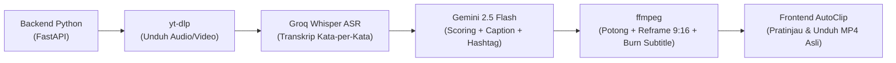

# 🎬 AutoClip AI Studio

> **Versi:** v2.4.0 | **Diperbarui:** 25 November 2026

AutoClip AI Studio adalah aplikasi berbasis **React 18 + Vite 6 + Tailwind CSS v3** yang dirancang untuk membantu eksplorasi, pratinjau, kurasi, dan alur kerja pembuatan klip vertikal (9:16) dari video sumber (seperti YouTube), lengkap dengan dukungan integrasi **Google Gemini 2.5 Flash**, **Groq Cloud (Whisper Large v3)**, `yt-dlp`, serta **FastAPI** untuk pemrosesan backend.

> **Catatan Status Saat Ini:** Sebagian fitur utama pada antarmuka sudah tersedia dan berjalan sebagai studio interaktif/demo, sementara pemrosesan audio/video asli secara end-to-end (transkrip verbatim real-time untuk URL kustom, pemotongan video asli dengan narasi nyata, serta integrasi pipeline backend penuh) berada pada daftar perbaikan prioritas berikutnya.

---

## ✨ Fitur Utama

### 1. Galeri Klip & Panel Kontrol
- **Target Jumlah Klip Fleksibel:** Atur target jumlah klip (1–8+ klip) melalui slider.
- **Tambah Klip Manual:** Tambahkan klip kustom melalui modal form (judul, timestamp, caption, dan transkrip).
- **Filter & Pencarian:** Saring klip berdasarkan skor viral (`90+`, `85+`, atau semua) serta cari berdasarkan kata kunci judul atau caption.
- **Edit & Hapus Klip:** Perbarui judul, timestamp, dan subtitle secara in-line atau hapus klip yang tidak diperlukan.
- **Navigasi Tab:** Beralih cepat antara tab **Galeri Klip**, **Studio**, dan **API & Hardware**.

### 2. Pemutar Video 9:16 & Panel Intelijen Sumber
- **Pratinjau 9:16 & 16:9:** Pemutar YouTube embed (`youtube-nocookie.com`) yang disinkronkan dengan rentang waktu klip, dilengkapi simulasi gaya subtitle **Hormozi Style** dan **Karaoke**, toggle mute/unmute, mode fullscreen, serta switcher rasio **9:16 Vertikal** dan **16:9 Original**.
- **Panel Intelijen Video Sumber:** Menampilkan pemutar video sumber, statistik (views, likes, durasi, jumlah klip), deskripsi, AI Key Takeaways, tag/hashtag channel, serta tautan langsung ke YouTube.
- **Simulasi Pipeline 6 Tahap:** Visualisasi progres tahap (*Whisper → Segmentasi → Scoring → Copywriting → Face-Track → Render*) beserta terminal log animasi dan efek *confetti* saat selesai.

### 3. Ekspor & Unduhan Klip
- **In-Browser Renderer:** Pratinjau/rekaman berbasis Canvas `720×1280` dengan `MediaRecorder`, burn-in subtitle, tone audio, dan badge face-track.
- **Ekspor Teks (.txt):** Unduh metadata, subtitle SRT, dan perintah `yt-dlp` per klip maupun batch export untuk semua klip.
- **Skrip CLI (`download_clip.py`):** Utilitas Python untuk mengunduh/memotong video MP4 melalui `yt-dlp`.

### 4. Sumber Video Dinamis (`src/videoService.js`)
- Mengambil metadata dasar video melalui `fetchYouTubeMetadata(url)` (`noembed.com`) dengan mekanisme fallback jika permintaan tidak tersedia.
- Menghasilkan klip dan transkrip kontekstual melalui `generateClipsForSource(...)` menggunakan **Gemini 2.5 Flash**, dilengkapi *zero-failure fallback* adaptif berdasarkan topik (bisnis, teknologi, kesehatan, edukasi).
- Menyediakan `PRESET_SOURCES` terverifikasi untuk ganti sumber cepat tanpa reload serta sinkronisasi URL YouTube kustom.

---

## 🛠️ Tech Stack & Layanan API

| Kategori | Teknologi / Layanan | Keterangan |
|----------|---------------------|------------|
| **Frontend** | React 18, Vite 6, Tailwind CSS v3 | UI studio dark mode, `lucide-react`, `canvas-confetti` |
| **LLM & ASR** | Google Gemini 2.5 Flash, Groq Whisper Large v3 | Generasi ide/caption klip & transkripsi audio |
| **API Opsional** | OpenAI, DeepSeek | Kolom input API key tersedia di antarmuka |
| **Media & Backend** | `yt-dlp`, `ffmpeg`, Python (FastAPI) | Ekstraksi media, pemrosesan audio/video, dan endpoint API |

---

## 📁 Struktur Proyek

```text
autoclip/
├── src/
│   ├── App.jsx              # Komponen utama aplikasi & antarmuka studio
│   ├── videoService.js      # Pengambilan metadata & generator klip AI / fallback
│   ├── index.css            # Entry point Tailwind CSS
│   └── main.jsx             # Entry point React
├── .env                     # API keys lokal/produksi (jangan di-commit ke publik)
├── .env.example             # Template variabel lingkungan tanpa nilai rahasia
├── authentic_clips.json     # Contoh dataset klip otentik (dr. Tirta)
├── transcript_clean.json    # Transkrip bersih hasil olahan VTT
├── video_info.json          # Contoh metadata video sumber
├── drtirta_sub.id.vtt       # Subtitle WebVTT mentah dari yt-dlp
├── download_clip.py         # Skrip CLI pemotongan video via yt-dlp
├── package.json             # Dependensi & skrip npm (v2.4.0)
├── vite.config.js           # Konfigurasi Vite (port 5173, host: true)
├── tailwind.config.js       # Konfigurasi Tailwind CSS
└── dist/                    # Hasil build produksi
```

---

## 🚀 Panduan Instalasi & Menjalankan (Lokal)

### Prasyarat
- **Node.js** (disarankan LTS) & **npm**
- **Python 3.x** (disarankan 3.11–3.13) dengan `pip`
- **`yt-dlp`** dan **`ffmpeg`** terpasang serta terdaftar di `PATH` sistem untuk kebutuhan ekstraksi dan pemrosesan video/audio

### 1. Setup Frontend
```bash
npm install
cp .env.example .env
```
Isi variabel API key yang diperlukan di dalam berkas `.env` (seperti key Google Gemini dan Groq Cloud), lalu jalankan server pengembangan:
```bash
npm run dev
```

### 2. Build Produksi Frontend
```bash
npm run build
```

### 3. Menjalankan Backend Python (FastAPI)
Pastikan dependensi Python terpasang di lingkungan virtual (`.venv`), lalu jalankan server FastAPI:
```bash
uvicorn main:app --reload --host 0.0.0.0 --port 8000
```
Periksa status layanan melalui endpoint `/health` sebelum menghubungkannya ke frontend.

---

## 🔄 Arsitektur Target Pipeline Nyata



---

## 📌 Roadmap & Perbaikan Prioritas

### Prioritas Tinggi
- [ ] **Transkrip Verbatim Asli untuk URL Kustom:** Unduh audio via `yt-dlp`, kirim ke Groq Whisper ASR, dan petakan hasil transkrip kata per kata.
- [ ] **Unduhan MP4 Video Asli:** Sambungkan proses render ke backend Python (`yt-dlp` + `ffmpeg`) agar hasil MP4 berisi rekaman & audio asli video, bukan sekadar canvas render.
- [ ] **Metadata URL Kustom yang Andal:** Tambahkan proxy backend atau YouTube Data API v3 agar metadata video kustom tidak bergantung pada akses jaringan langsung browser/sandbox.
- [ ] **Pipeline Nyata (Non-Simulasi):** Hubungkan tahap proses ke alur backend sungguhan.

### Prioritas Sedang & Pengembangan Lanjutan
- [ ] **Optimasi Bundle:** Terapkan code-splitting (`React.lazy` + `Suspense`) dan pemisahan vendor chunk untuk mengurangi ukuran chunk JS (`> 500 KB`).
- [ ] **Sinkronisasi Subtitle & Klip Manual:** Gunakan YouTube IFrame API (`YT.Player`) untuk sinkronisasi waktu yang akurat dan isi otomatis `youtubeId` aktif saat menambah klip manual.
- [ ] **Badge Akurasi Transkrip & Thumbnail:** Bedakan label antara hasil verbatim dan hasil AI-generated, serta perbaiki fallback thumbnail agar terhindar dari isu CORS.
- [ ] **Enhancement:** Dukungan upload video lokal, ekspor ke platform sosial, batch/playlist processing, penyimpanan sesi di `localStorage`, pratinjau subtitle canvas langsung di kartu, dukungan multi-bahasa, toggle tema terang/gelap, dan riwayat URL.